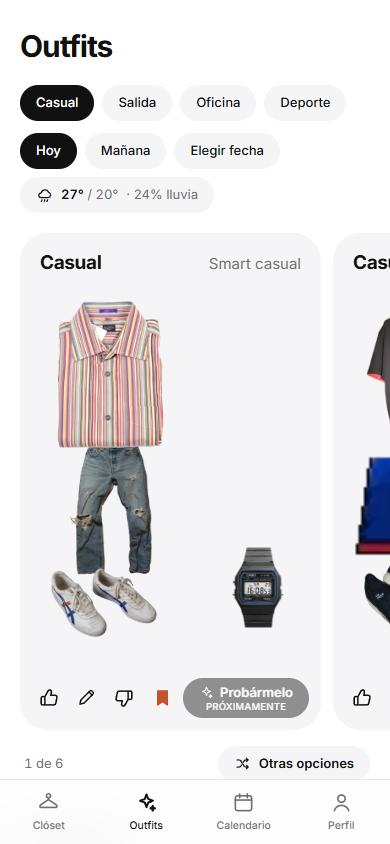

# percha · clóset digital

Web app mobile-first para digitalizar tu ropa y armar outfits.
- **Entrega 1 · Clóset:** carga con IA, grilla, búsqueda y filtros.
- **Entrega 2 · Outfits:** propuestas por ocasión (casual, salida, oficina, deporte) según el clima del día, con like/dislike, cambio de prendas y outfits guardados.
- **Entrega 3 · Calendario:** mes con un outfit por día (miniatura del collage), asignar uno guardado o generar uno nuevo con el clima de ese día.
- **Entrega 4 · Avatar y prueba virtual:** tu foto de cuerpo entero (sin fondo) y "Probármelo" con un Space gratis de Hugging Face; el render queda guardado y se ve en la tarjeta, en los guardados y en el calendario.



- **Frontend:** Vite + React + TypeScript + Tailwind v4, español / inglés, modo claro / oscuro.
- **Datos:** Supabase (Postgres + Storage privado). Sin credenciales corre en **modo demo**, con los datos en el navegador (IndexedDB).
- **IA, 100 % en el navegador y gratis** (Transformers.js en un Web Worker):
  - Quitar fondo: `briaai/RMBG-1.4` (licencia de uso no comercial, OK para uso personal).
  - Tipo, estilo, color, estampado y marca sugerida: CLIP (`Xenova/clip-vit-base-patch32`), zero-shot. En el navegador solo corre el encoder de **visión q8** (89 MB); los embeddings de texto vienen precalculados en fp32 (`src/lib/ai/clip-text-embeddings.json`).
  - Colores: k-means en CIELAB sobre los píxeles de la prenda recortada, corregido por CLIP cuando la luz engaña (un jean con luz cálida da gris).
  - Los modelos se descargan la primera vez (~180 MB en total) y quedan cacheados. Si algo falla, la prenda se guarda igual con la foto original y etiquetas manuales.
  - Si cambiás prompts o la taxonomía (`src/lib/taxonomy.ts`, `src/lib/ai/prompts.ts`), regenerá los embeddings: `npm run clip:embed` (hay un test que avisa si quedaron desactualizados).
- **Generador de outfits** (`src/lib/outfits/engine.ts`, reglas puras con tests):
  - Plantilla por ocasión (arriba + abajo + calzado, abrigo según el clima, y gorra, lentes y reloj opcionales) con rango de formalidad.
  - Clima de [Open-Meteo](https://open-meteo.com) (gratis, sin key): máxima, mínima y probabilidad de lluvia del día elegido. Ubicación: ciudad elegida en Perfil o la del dispositivo.
  - Armonía de color: neutros (el jean cuenta como neutro) + como mucho 2 acentos que no choquen, y nunca dos estampados.
  - Evita repetir prendas planificadas en el calendario en los ±7 días, aprende de los like/dislike (pesos por prenda y por par) y varía con aleatoriedad controlada.
- **Prueba virtual** ([OOTDiffusion](https://huggingface.co/spaces/levihsu/OOTDiffusion), licencia no comercial, OK para uso personal): se prueba la parte de arriba (o el abrigo) y después la de abajo sobre ese resultado, ~14 s cada una. Gorra, lentes, reloj y calzado no se renderizan. Corre en ZeroGPU: **sin cuenta de Hugging Face la cuota diaria alcanza para 1 o 2 pruebas**; con un token "Read" de una cuenta gratis (Perfil → Más cuota) hay más. El token queda solo en ese dispositivo. Por qué no Kolors ni IDM-VTON: el primero no expone API y el segundo solo prueba la parte de arriba.

## Puesta en marcha (unos 15 minutos)

### 1. Supabase (gratis)
1. Creá un proyecto en [supabase.com](https://supabase.com).
2. **SQL Editor →** pegá todo `supabase/schema.sql` **→ Run**. Crea la tabla `garments`, el bucket privado `garments` y las reglas de seguridad.
3. **SQL Editor →** pegá todo `supabase/002_outfits.sql` **→ Run** (entrega 2). Agrega la columna `pattern` a `garments` y las tablas `outfits` y `preferences`, con RLS. Es idempotente: se puede correr más de una vez.
4. **SQL Editor →** pegá todo `supabase/003_calendar.sql` **→ Run** (entrega 3). Crea `calendar_entries` (un outfit por día) con RLS; si borrás un outfit, sus días quedan libres.
5. **SQL Editor →** pegá todo `supabase/004_avatar.sql` **→ Run** (entrega 4). Agrega `preferences.avatar_path` (la foto del avatar); los renders van en `outfits.tryon_path`.
6. **Authentication → Sign In / Providers → Email:** dejá prendido *Enable Email provider* (si se apaga, la app dice "Email logins are disabled") y apagá solo *Confirm email*. **Save.** El cambio tarda unos segundos en aplicarse.
7. **Project Settings → Data API:** copiá la *Project URL*. **API Keys:** copiá la *publishable key* (`sb_publishable_…`).
8. Chequeo rápido: en **Table Editor** tienen que aparecer `garments`, `outfits`, `preferences` y `calendar_entries`, y en **Storage** el bucket `garments`. Fijate que estés en el proyecto correcto (el id está en la URL del dashboard).

### 2. Código en GitHub
Subí esta carpeta a un repo (puede ser privado).

### 3. Vercel (gratis)
1. *Add New → Project →* importá el repo (Vercel detecta Vite solo).
2. *Environment Variables:*
   - `VITE_SUPABASE_URL` = Project URL
   - `VITE_SUPABASE_ANON_KEY` = anon / publishable key
3. *Deploy.*

Con la CLI (`npx vercel`) desde PowerShell 5.1, cargá las variables con `vercel env add NOMBRE production --value ...`: si las pasás por la tubería (`|`), PowerShell les agrega un BOM invisible y la URL de Supabase queda rota.

### 4. Primer uso
1. Abrí la URL de Vercel y creá tu cuenta (email + contraseña).
2. Como es una app de un solo usuario: en Supabase → **Authentication → Sign In / Providers**, desactivá **Allow new users to sign up**.
3. En el iPhone: Compartir → *Agregar a pantalla de inicio* para usarla como app a pantalla completa.
4. Recomendado: en **Perfil → Modelos de IA → Precargar ahora**, con wifi.
5. En **Perfil → Ciudad para el clima** elegí tu ciudad (si no, la app pide la ubicación).
6. En **Perfil → Tu avatar** subí una foto de cuerpo entero (de frente, brazos al costado, ropa ajustada). Opcional: un token de Hugging Face para más cuota de prueba virtual.

## Desarrollo local
```bash
npm install            # si falla onnxruntime-node por la red: npm install --ignore-scripts
cp .env.example .env   # completá las dos variables (o dejalo vacío para modo demo)
npm run dev            # con tu Supabase
npm run dev:demo       # modo demo local en :5174 (ignora el .env), para probar sin tocar la nube
npm test               # tests del motor de outfits, calendario, prueba virtual, descripciones y embeddings de CLIP
```

## Estructura
```
src/
  config/brand.ts        nombre y color de acento (cambiar acá la identidad)
  lib/taxonomy.ts        categorías, colores, estilos, marcas (base del etiquetado y del generador)
  lib/ai/                worker de IA, cliente, prompts de CLIP y pipeline de procesamiento de fotos
  lib/outfits/           motor de reglas (puro, con tests) y contexto de outfits/preferencias
  lib/weather.ts         Open-Meteo: pronóstico del día y búsqueda de ciudades
  lib/calendar.ts        grilla del mes, fechas y uso reciente (puro, con tests)
  lib/tryon/             prueba virtual: interfaz TryOnProvider, OOTDiffusion, imágenes y token
  lib/store/             capa de datos: Supabase o local (misma interfaz)
  pages/                 Clóset, Agregar prendas, Outfits, Calendario, Perfil
  components/            UI (botones, chips, sheet), prenda (form, tarjeta, detalle), outfit (collage, tarjeta, cambio)
supabase/schema.sql      tabla de prendas, bucket y políticas RLS
supabase/002_outfits.sql estampado, outfits y preferencias (entrega 2)
supabase/003_calendar.sql calendario: un outfit por día (entrega 3)
supabase/004_avatar.sql  foto del avatar (entrega 4)
docs/screenshots/        capturas de cada entrega
```

## Próximas entregas
5. Wishlist, estadísticas, modo valija.
